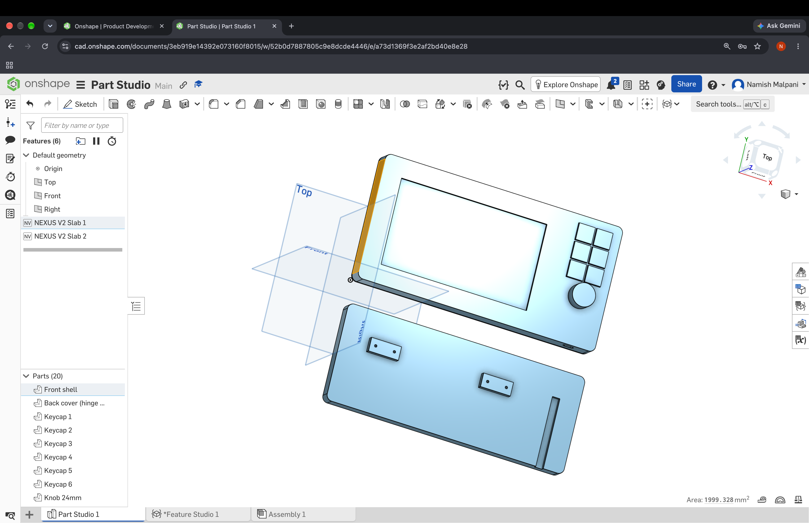
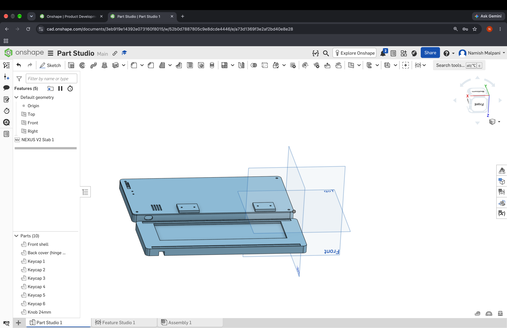
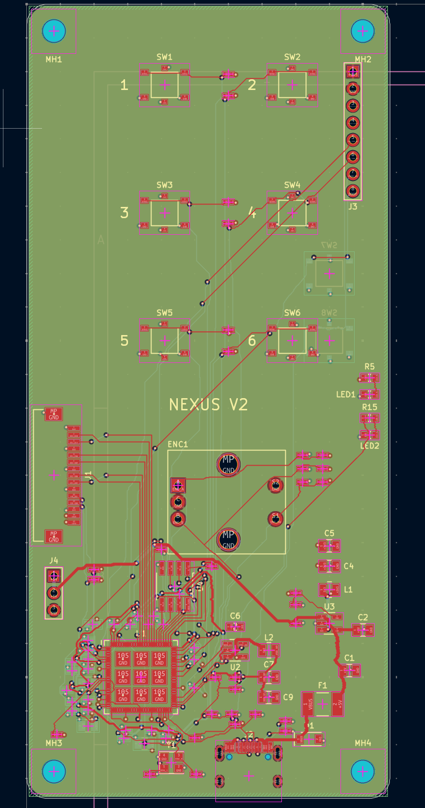
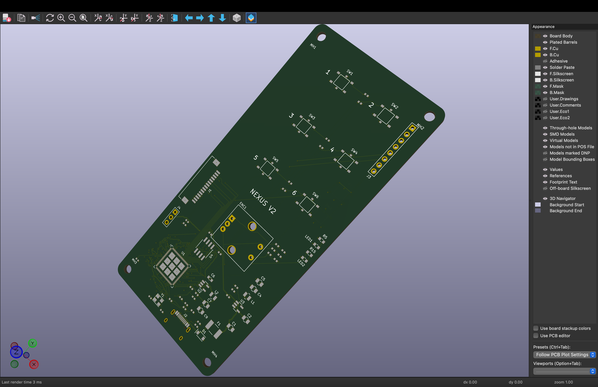

# NEXUS V2 – desk control panel

NEXUS V2 is a desk control panel in the spirit of a Stream Deck. It has a 7" touchscreen, six programmable keys and a volume knob, and connects to a Mac or PC with a single USB-C cable. It is built around an **ESP32-P4** on a custom 4-layer PCB. No dev board is used.

## What it is and how to use it

1. Plug NEXUS into your computer with one USB-C cable. That single cable provides both power and data.
2. **Six keys (2 × 3):** each one triggers a computer shortcut. The firmware sends F13–F18, and the companion app maps each one to any action (launch an app, mute the mic, run a macro…).
3. **Knob:** turn it to change the volume and press it to mute or unmute.
4. **7" touchscreen:** shows CPU / RAM / GPU / storage, per-app usage, screen time and notifications. The sidebar switches between modes: **Coding, Study, Focus, Calm** (customisable).
5. **Tilt:** the screen sits on a weighted base with friction hinges. Tilt it to any angle from 15° to 70° and it stays there.

## Why I made it

I made NEXUS because I was struggling with small daily tasks. While browsing the internet, if I wanted to check my CPU, RAM, storage or any usage, I had to leave my browser and open Task Manager. To check my screen time, I had to go through Settings. To check my notifications, I had to open my phone or Gmail. And my device didn't have modes at all. That's why I created NEXUS.

Everything is in front of you: your CPU, GPU, RAM and storage. Click once and it tells you which app is using what. You get different modes (coding mode, study mode, focus mode, calm mode), and you can customise them however you want. Screen time shows you which app you used and for how long. You can enable notifications for any app you like, and disable them too.

## Screenshots

| Full 3D assembly (front) | Full 3D assembly (back + base) |
|---|---|
|  |  |

| PCB layout | PCB 3D render |
|---|---|
|  |  |

- **Schematic:** `pcb/NEXUS_V2.kicad_sch` (KiCad 10). A PDF export goes in `images/`.
- **Pinout diagram:** see [PIN_MAP.md](PIN_MAP.md).

## Hardware

| Block | Part |
|---|---|
| MCU | Espressif ESP32-P4NRW16X (QFN-104, 16 MB PSRAM) + 16 MB QSPI flash |
| Display | Waveshare 7-DSI-TOUCH-A, 720 × 1280 IPS, MIPI-DSI 2-lane, I2C touch |
| Keys | 6 × C&K PTS526 SPG15 SMTR2 LFS (320 gf), 19 mm pitch, pull-ups + firmware debounce |
| Encoder | EC11 incremental encoder with push switch |
| Power | USB-C 5 V → 2 × TLV62569 bucks (3V3 and VDD_HP core); internal LDOs for flash, PSRAM and MIPI |
| USB | HRO TYPE-C-31-M-12, USB 2.0 High-Speed to the ESP32-P4 OTG PHY |
| PCB | 54 × 118 mm, 4 layers (signal / GND / 3V3 / signal); KiCad DRC: 0 errors, 0 warnings, 0 unconnected |

## Enclosure

- **Form:** a slab on a stand. The screen is on the left and the keys and knob are on the right. The PCB sits *beside* the display, so the slab is only as thick as the display.
- **Base:** weighted with ~300 g of M12 steel washers in a pocket at the front. Two constant-torque hinges allow a 15–70° tilt.
- **USB-C plug:** an L-shaped plug sits hidden in a pocket in the base, and the cable exits at the rear.
- **CAD:** fully parametric Onshape FeatureScript (`cad/NEXUS_V2_slab_enclosure.fs`). Parameters: display depth, hinge hole spacing and screw size.
- **Printed parts (10):** front shell, back cover, base, 6 keycaps, 24 mm knob.
- **Materials:** matte PLA or PETG.

## Files

| Item | Location |
|---|---|
| STEP file for each part | `cad/NEXUS_V2_parts_STEP.zip` (10 parts) |
| Full assembly STEP | `cad/NEXUS_V2_full_assembly.step` |
| Onshape source | https://cad.onshape.com/documents/3eb919e14392e073160f8015/w/52b0d7887805c9e8dcde4446/e/a73d1369f3e2af2bd40e8e28 |
| KiCad project | `pcb/NEXUS_V2.kicad_pro`, `.kicad_sch`, `.kicad_pcb`, `.kicad_prl` + `NEXUS_V2_Custom.kicad_sym`, `NEXUS_V2_Footprints.pretty/`, `fp-lib-table`, `sym-lib-table` |
| Gerbers + drill | `pcb/gerbers.zip` |
| Firmware | `firmware/`: ESP-IDF project, untested (keys → F13–F18, knob → volume / mute) |
| BOM with links | `BOM.csv` |
| Pin map | `PIN_MAP.md` |
| Fabrication status | `pcb/FABRICATION_STATUS.txt` |

## Status and known issues (rev B)

- **Verified:** KiCad DRC is clean. The switch footprint was checked against the C&K datasheet. The encoder footprint matches the ALPS EC11 reference and the listing dimensions (6 mm D-shaft, M7 thread, 15 mm shaft, 15 × 12 mm body). The display outline and depth match the Waveshare drawing.
- **To confirm on the real parts before ordering boards:**
  - encoder pin spacing (caliper check)
  - display cable contact side, which decides the exact J1 connector part
  - hinge hole pattern
- **Rev C plan:**
  - rear-facing USB-C through the back cover
  - a branded encoder (Bourns PEC11R) for production
  - display UI firmware: MIPI-DSI + LVGL, plus a USB link to the companion app

## Bill of materials

Full list with links: [BOM.csv](BOM.csv). Prices in INR incl. GST (USD converted at 1 USD = 94.85 INR).

| Product | Description | Link | Price (INR) |
|---|---|---|---|
| Display | Waveshare 7-DSI-TOUCH-A. 7in 720x1280 IPS MIPI-DSI touch display; includes DSI-Cable-12cm + 5V power cable. Already owned. | [link](https://zbotic.in/product/waveshare-7inch-dsi-capacitive-touch-display/) | 6442.80 |
| Rotary encoder | FlyRobo EC11 15 mm half-shaft SKU 3370. Incremental encoder with push switch (volume / mute). Price = Rs 47 encoder + Rs 100 FlyRobo delivery. | [link](https://www.flyrobo.in/ec11-rotary-encoder-half-shaft-handle-potentiometer-15mm) | 147.00 |
| MCU | ESP32-P4NRW16X. Espressif ESP32-P4, QFN-104, 16 MB PSRAM in package | [link](https://www.lcsc.com/search?q=ESP32-P4NRW16X) | 450.03 |
| Flash | W25Q128JVSIQ. 16 MB QSPI flash, SOIC-8 208 mil | [link](https://www.lcsc.com/search?q=W25Q128JVSIQ) | 206.32 |
| Buck regulator x2 | TLV62569DBVR. 3 A step-down (core VDD_HP and 3V3) | [link](https://www.ti.com/product/TLV62569) | 12.56 |
| Inductor x2 | Murata DFE252012F-2R2M. 2.2 uH, Isat >= 3 A, 2520 | [link](https://www.lcsc.com/search?q=DFE252012F-2R2M) | 6.24 |
| Crystal | 40 MHz 3225. 40 MHz, CL 10 pF, +-10 ppm, 3225 | [link](https://www.lcsc.com/search?q=40MHz%203225%20crystal%2010pF) | 4.78 |
| USB-C receptacle | HRO TYPE-C-31-M-12. 16-pin USB 2.0 Type-C, LCSC C165948 | [link](https://lcsc.com/product-detail/C165948.html) | 9.25 |
| FPC connector | Amphenol SFW15R-1STAE1LF (or Molex 52207-1560). 15-pin 1.0 mm FPC ZIF (display DSI). Final pick depends on cable contact side | [link](https://lioncircuits.com/parts/SFW15R-1STE1LF) | 90.34 |
| Tactile switch x8 | C&K PTS526 SPG15 SMTR2 LFS, Robu SKU R185029, Rs 13 each incl. GST. 6 keys + BOOT and RESET. Robu delivery is free above Rs 999; below that it is added at checkout. | [link](https://robu.in/product/pts526-spg15-smtr2-lfs-ck-5-2mm-1-5mm-5-2mm-320gf-smd-tactile-switches-rohs/) | 104.00 |
| TVS diode | SMF5.0A. 5 V TVS on VBUS, SOD-123F | [link](https://www.lcsc.com/search?q=SMF5.0A) | 5.18 |
| ESD diode x2 | TI TPD1E0B04. 0.13 pF bidirectional ESD (USB D+/D-) | [link](https://www.lcsc.com/search?q=TPD1E0B04) | 31.70 |
| PTC fuse | Bourns MF-MSMF110. 1.1 A hold, 1812 | [link](https://www.lcsc.com/search?q=MF-MSMF110) | 2.89 |
| LED x2 | 0603 LED green / blue. Power and user LEDs | [link](https://www.lcsc.com/search?q=0603%20LED) | 2.66 |
| Capacitor 10uF x6 | 10uF 10V X5R 0805 | [link](https://www.lcsc.com/search?q=10uF%200805%2010V%20X5R) | 8.99 |
| Capacitor 22uF x3 | 22uF 10V X5R 0805 | [link](https://www.lcsc.com/search?q=22uF%200805%2010V) | 15.08 |
| Capacitor 4.7uF x2 | 4.7uF 10V X5R 0603 | [link](https://www.lcsc.com/search?q=4.7uF%200603%2010V) | 3.00 |
| Capacitor 1uF x6 | 1uF 10V X5R 0402 | [link](https://www.lcsc.com/search?q=1uF%200402%2010V) | 1.31 |
| Capacitor 0.1uF x23 | 0.1uF 16V X7R 0402 | [link](https://www.lcsc.com/search?q=100nF%200402%2016V%20X7R) | 3.49 |
| Capacitor 10nF x2 | 10nF 16V X7R 0402 | [link](https://www.lcsc.com/search?q=10nF%200402) | 0.30 |
| Capacitor 22pF | 22pF C0G 0402 | [link](https://www.lcsc.com/search?q=22pF%200402%20C0G) | 0.15 |
| Capacitor 15pF x2 | 15pF C0G 0402. Crystal load (tune) | [link](https://www.lcsc.com/search?q=15pF%200402%20C0G) | 0.30 |
| Resistor 10k x12 | 10k 1% 0402. Pull-ups (buttons, encoder, straps) | [link](https://www.lcsc.com/search?q=10k%200402%201%) | 0.57 |
| Resistor 5.1k x2 | 5.1k 1% 0402. USB-C CC pull-downs | [link](https://www.lcsc.com/search?q=5.1k%200402) | 0.09 |
| Resistor 2.2k x2 | 2.2k 0402. I2C pull-ups | [link](https://www.lcsc.com/search?q=2.2k%200402) | 0.09 |
| Resistor 1k x2 | 1k 0603. LED resistors | [link](https://www.lcsc.com/search?q=1k%200603) | 0.09 |
| Resistor (dividers) x6 | 453k / 100k / 499k x2 / 4.02k / 1M, 1% 0402. Buck feedback, DSI REXT, misc | [link](https://www.lcsc.com/search?q=0402%201%%20resistor) | 0.28 |
| Pin header 1x8 (J3) | Shekki 1x40 single-row male header, 2.54 mm, single strip. J3 programming header; cut 8 pins. | [link](https://www.amazon.in/dp/B0H467TGFM) | 49.00 |
| Pin header 1x3 right-angle (J4) | Electronic Spices 1x40 right-angle (90 deg) male header, pack of 5 (smallest pack on Amazon). J4 display 5 V header; cut 3 pins from one strip. | [link](https://www.amazon.in/dp/B0BG7KGL77) | 80.00 |
| PCB x5 | NEXUS V2 custom PCB rev B, 4-layer, 118 x 54 mm, 1.6 mm, ENIG. Manufacturing files: pcb/gerbers.zip in this repo (upload to JLCPCB to reproduce the quote). JLCPCB minimum order is 5 boards; 1 is used, 4 are spares. | [gerbers.zip](pcb/gerbers.zip), [JLCPCB](https://jlcpcb.com/quote) | 7967.40 |
| Friction hinges | TAODAN torque friction hinges, 1 left + 1 right, mounting screws included. Holds the slab at any tilt angle. | [link](https://www.amazon.in/dp/B0BNH8985Y) | 2201.21 |
| Base weight | 50 x M12 SS304 flat washers (DIN 125, about 6 g each, about 300 g total). Stacked in the pocket under the base to stop the device tipping. | [link](https://www.amazon.in/dp/B0H122NK8H) | 229.00 |
| Enclosure screws x6 | M3 self-tapping: 4x M3x6, 2x M3x12. Hold the back cover and the PCB (not the hinge screws). Already owned. | Owned (from home, no link) | 0.00 |
| Anti-slip feet | nuoshen clear self-adhesive rubber feet, 100 pcs (4 used under the base). | [link](https://www.amazon.in/dp/B0F7FKDTF9) | 111.00 |
| USB-C cable | Verilux 3 m USB-C to USB-C, 90 deg right-angle end, 480 Mbps data + 100 W. The L end plugs into NEXUS inside the base. | [link](https://www.amazon.in/dp/B0F942Z4LY) | 599.00 |
| 23AWG single-strand wire (black+red, 1+1 m) (tool) | CBL-QC0413. Assembly / testing tool. Already owned. | [link](https://quartzcomponents.com/search?q=CBL-QC0413) | 29.50 |
| Jumper wire combo M-M / M-F / F-F (10 each) (tool) | CBL-QC0613. Assembly / testing tool. Already owned. | [link](https://quartzcomponents.com/search?q=CBL-QC0613) | 61.36 |
| DT830D digital multimeter (tool) | TLS-QC0298. Assembly / testing tool. Already owned. | [link](https://quartzcomponents.com/search?q=TLS-QC0298) | 218.30 |
| MB102 breadboard 830 points (tool) | TLS-QC0412. Assembly / testing tool. Already owned. | [link](https://quartzcomponents.com/search?q=TLS-QC0412) | 80.24 |
| Solder wire 5 g (tool) x2 | TLS-QC0863. Assembly / testing tool. Already owned. | [link](https://quartzcomponents.com/search?q=TLS-QC0863) | 54.28 |
| RMA-223 solder flux paste (tool) | TLS-QC0864. Assembly / testing tool. Already owned. | [link](https://quartzcomponents.com/search?q=TLS-QC0864) | 43.66 |
| 25 W soldering iron (tool) | TLS-QC1041. Assembly / testing tool. Already owned. | [link](https://quartzcomponents.com/search?q=TLS-QC1041) | 97.94 |
| Soldering iron stand (tool) | TLS-QC2658. Assembly / testing tool. Already owned. | [link](https://quartzcomponents.com/search?q=TLS-QC2658) | 28.32 |
| Wire stripper / cutter 130 mm (tool) | TLS-QC3658. Assembly / testing tool. Already owned. | [link](https://quartzcomponents.com/search?q=TLS-QC3658) | 41.30 |
| SMT stencil | JLCPCB stencil, non-framework, top + bottom on one sheet, 0.12 mm, electropolished. Needed by the vendor to apply solder paste for the ESP32-P4 | [link](https://jlcpcb.com/pcb-stencil) | 663.95 |
| Double-sided foam tape | 3M Scotch heavy-duty double-sided foam tape (holds 4.5 kg per metre). Holds the display in the front shell and seals the washers into the base pocket. | [link](https://www.amazon.in/dp/B00N1U9AJS) | 171.00 |
| Shipping + customs (JLCPCB + LCSC) | PCBs, stencil and LCSC parts shipped from China in one combined parcel. Courier fee and Indian customs duty are calculated by JLCPCB/LCSC at checkout. | [link](https://jlcpcb.com) | At checkout |
| Vendor soldering charge | Local vendor solders the ESP32-P4 and all SMD parts (both sides). | Local shop | Ask vendor |
| TOTAL build cost | Everything above except the tools. Not included: shipping + customs from China and the vendor charge. |  | 19621.05 |
| Tools (already owned) | Not part of the build cost |  | 654.90 |
